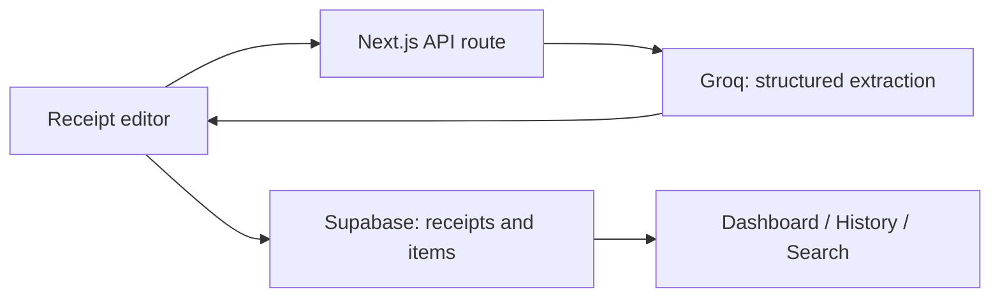

# Notaku

A fullstack expense-tracking application that turns receipt text into editable purchase records using an LLM. Built with Next.js, TypeScript, Groq, Supabase, and Zustand.

## What to explore

- Receipt text processing through a server-side Groq endpoint.
- Editable purchase records and item categories.
- Spending dashboard, history, search, and monthly AI analysis.
- Supabase authentication and persistence integrations.

## Run locally

Use Node.js 22 LTS and npm. Create `.env.local` using the variable names in [docs/configuration.md](docs/configuration.md), then run:

```bash
git clone https://github.com/nidaamalia/notaku.git
cd notaku
npm ci
npm run dev
```

The development server runs on http://localhost:3004. Live persistence requires a Supabase project with the tables and access policies expected by the queries. A database migration is not bundled, so a new database is not automatically provisioned. Missing Supabase configuration enables a limited mock client, not a complete offline demo.

## Architecture



| Concern | Code |
| --- | --- |
| Receipt extraction | [API route](app/api/process-receipt/route.ts) |
| Prompt and categories | [categories.ts](src/lib/categories.ts) |
| Database operations | [receiptQueries.ts](src/lib/receiptQueries.ts) |
| Client state | [useAppStore.ts](src/stores/useAppStore.ts) |
| Authentication | [AuthProvider.tsx](src/components/AuthProvider.tsx) |

## Checks

```bash
npm run type-check
npm run build
npx tsx --test tests/receipt-input.test.ts
```

## Engineering boundaries

This is a product prototype. AI extraction needs human review: valid JSON does not guarantee correct totals, dates, or categories. Before a public deployment, verify database row-level policies, authenticate and rate-limit the AI endpoints, and restrict diagnostic routes. Do not use real financial records in an unrestricted demo.

The next useful iteration is runtime validation of model output and a repeatable extraction-quality dataset. No accuracy or production-readiness claim is made here.
